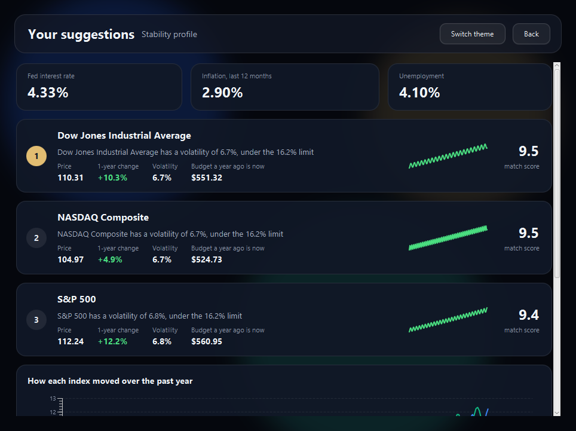

# Glassfolio

A Java desktop app that suggests a U.S. market index (S&P 500, NASDAQ Composite or Dow Jones) based on your risk profile, using live data from FRED (Federal Reserve Economic Data).



*Screenshot with made-up sample data.*

## What it does

- **Stability** profile: picks the index whose price moved the least over the last year (lowest volatility).
- **Growth** profile: picks the index that rose the most over the last year.
- Shows each suggestion with its reason, price, 1-year change, volatility and what your budget would be worth if you had invested it a year ago.
- Charts all three indexes over the past year.
- Shows the current Fed interest rate, inflation and unemployment.
- The start screen shows a live market overview and explains each risk profile in plain words.
- Light and dark themes, switchable from either screen.
- Fills any window size; press F11 for full screen.

## Requirements

- Windows, macOS or Linux (it's a desktop app, so it doesn't run on phones)
- JDK 25
- JavaFX SDK 25 ([download from Gluon](https://gluonhq.com/products/javafx/))
- A free FRED API key ([request one here](https://fred.stlouisfed.org/docs/api/api_key.html))

## Run it

Get the code:
```powershell
git clone https://github.com/bryherd83/Glassfolio.git
cd Glassfolio
```

Set your API key as an environment variable. Never put it in the code.

**IntelliJ**
1. File → Project Structure → Libraries → + → Java, pick the JavaFX SDK's `lib` folder.
2. Run → Edit Configurations → `Main`:
   - VM options: `--module-path "<path to javafx-sdk>\lib" --add-modules javafx.controls --enable-native-access=javafx.graphics`
   - Environment variables: `FRED_API_KEY=<your key>`
3. Run `Main`.

**PowerShell**
```powershell
$env:FRED_API_KEY = "<your key>"
javac -d out --module-path "<path to javafx-sdk>\lib" --add-modules javafx.controls src\*.java
java --module-path "<path to javafx-sdk>\lib" --add-modules javafx.controls --enable-native-access=javafx.graphics -cp out Main
```

## Tests

`test/ModelTest.java` checks the math, strategies, ranking and input validation with fake data (no internet or JavaFX needed). Run commands are at the top of the file.

## Project layout

| Part | Classes |
|---|---|
| Screens | `StockApp`, `FormScreen`, `ParticleChart`, `MarketStrip`, `ProfileGuide`, `ResultsScreen` |
| Look | `GlassTheme`, `Theme`, `Styles`, `Motion`, `Backdrop`, `Sparkline` |
| Rules | `Stratgey`, `Stability`, `Growth`, `Suggestion`, `User` |
| Data | `MarketDataSource`, `FredClient`, `HistoryCache`, `Market`, `MarketConditions`, `Stock`, `EconomySnapshot` |

Class diagram, sequence diagram and storyboard: [docs/design.md](docs/design.md). User-facing changes: [docs/CHANGELOG.md](docs/CHANGELOG.md).

## Team

Blayne Ryherd and Luke Kawa.

Market data from [FRED](https://fred.stlouisfed.org/), Federal Reserve Bank of St. Louis.
