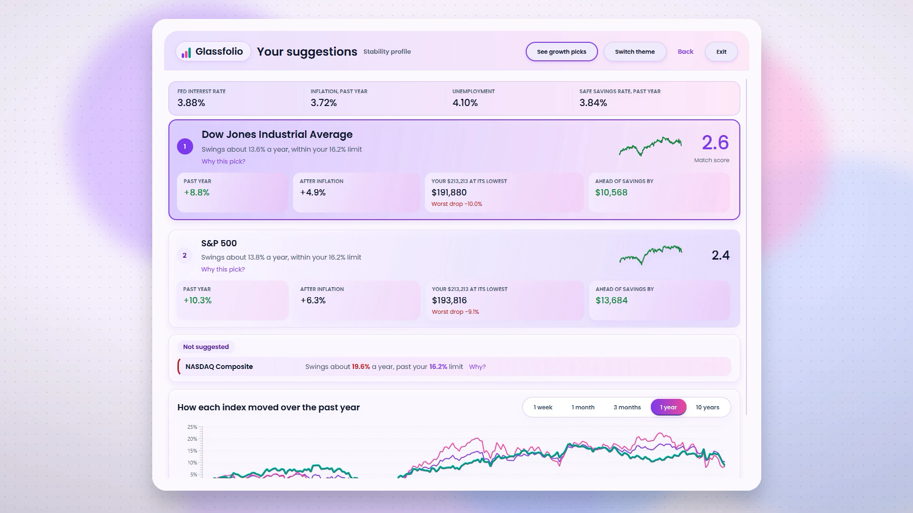

# Glassfolio

A Java desktop app that suggests a U.S. market index (S&P 500, NASDAQ Composite or Dow Jones) based on your risk profile, using live data from FRED (Federal Reserve Economic Data).



*Results screen with real FRED data (light theme).*

## What it does

- **Stability** profile: picks the index whose price moved the least over the last year (lowest volatility).
- **Growth** profile: picks the index that rose the most over the last year.
- Shows each suggestion with its reason, price, 1-year change, volatility, biggest drop, year range and what your budget would be worth if you had invested it a year ago, plus a worst case and the value after inflation.
- A "Why this pick?" panel on each result spells out the rule and the numbers behind it.
- Lists the indexes it left out and why, and switches to the other profile's picks with one click.
- Charts all three indexes over 1 week, 1 month, 3 months or 1 year.
- Shows the current Fed interest rate, inflation and unemployment.
- Compares each pick with keeping the same budget in safe savings (the past year's average 3-month Treasury bill rate).
- The start screen shows a live market overview and explains each risk profile in plain words.
- Not sure which profile fits? A 3-question risk quiz suggests one.
- "Remember me" (off by default) welcomes you back with your last name, budget and profile.
- Light theme (pink-violet glass) at launch and a dark theme (teal and lime), switchable from either screen.
- Opens full screen; press F11 or Esc to switch to a window.

## Requirements

- Windows, macOS or Linux (it's a desktop app, so it doesn't run on phones)
- JDK 25
- JavaFX SDK 25 ([download from Gluon](https://gluonhq.com/products/javafx/))
- A free FRED API key ([request one here](https://fred.stlouisfed.org/docs/api/api_key.html))

## Run it

Get the code:
```powershell
git clone https://github.com/bryherd83/Glassfolio.git
cd Glassfolio
```

The first time Glassfolio opens, it asks for your FRED API key. Paste it in and click Connect. The app checks the key with FRED and, if "Remember on this computer" is ticked, saves it for next time. To change it later, click "Change API key" under the form.

Developers can set the `FRED_API_KEY` environment variable instead (a key saved in the app wins). Never put the key in the code.

**IntelliJ**
1. File → Project Structure → Libraries → + → Java, pick the JavaFX SDK's `lib` folder.
2. Run → Edit Configurations → `glassfolio.Main`:
   - VM options: `--module-path "<path to javafx-sdk>\lib" --add-modules javafx.controls --enable-native-access=javafx.graphics`
   - Environment variables (optional): `FRED_API_KEY=<your key>`
3. Run `glassfolio.Main`.

**PowerShell**
```powershell
$env:FRED_API_KEY = "<your key>"   # optional; the app can ask for it instead
javac -d out\classes --module-path "<path to javafx-sdk>\lib" --add-modules javafx.controls (Get-ChildItem -Recurse src -Filter *.java).FullName
java --module-path "<path to javafx-sdk>\lib" --add-modules javafx.controls --enable-native-access=javafx.graphics -cp "out\classes;src" glassfolio.Main
```

**Runnable JAR**

Build it once (after the `javac` line above):
```powershell
Copy-Item -Recurse src\fonts out\classes\fonts -Force
jar --create --file out\glassfolio.jar --main-class glassfolio.Main -C out\classes .
```
Run it (JavaFX isn't inside the JAR, so point to the SDK):
```powershell
java --module-path "<path to javafx-sdk>\lib" --add-modules javafx.controls --enable-native-access=javafx.graphics -jar out\glassfolio.jar
```

## Tests

`test/ModelTest.java` checks the math, strategies, ranking and input validation with fake data (no internet needed). It needs the JavaFX SDK on the module path, because a few checks use GUI helpers:
```powershell
javac -d out\test --module-path "<path to javafx-sdk>\lib" --add-modules javafx.controls -sourcepath src test\ModelTest.java
java --module-path "<path to javafx-sdk>\lib" --add-modules javafx.controls -cp out\test ModelTest
```

## Project layout

| Package | What it holds | Classes |
|---|---|---|
| `glassfolio` | Starts the app | `Main` |
| `glassfolio.gui` | Screens, look and sound | `StockApp`, `BootScreen`, `FormScreen`, `AppIcon`, `DotField`, `EconomyPanel`, `RiskQuizPanel`, `StarField`, `KeyScreen`, `ParticleChart`, `MarketStrip`, `ProfileGuide`, `ResultsScreen`, `ResultsData`, `IndexChart`, `ChartReadout`, `GlassTheme`, `Theme`, `Styles`, `Motion`, `Backdrop`, `Sparkline`, `Chime` |
| `glassfolio.model` | Rules and market objects | `Strategy`, `Stability`, `Growth`, `Suggestion`, `User`, `Market`, `MarketConditions`, `Stock`, `EconomySnapshot`, `Period`, `RiskQuiz` |
| `glassfolio.data` | Loading data from FRED | `MarketDataSource`, `FredClient`, `HistoryCache`, `ApiKeyStore`, `VisitStore` |

The model never imports the GUI, so the rules don't depend on the screens.

Class diagram, sequence diagram, storyboard and [security and QA](docs/design.md#security-and-qa): [docs/design.md](docs/design.md). User-facing changes: [docs/CHANGELOG.md](docs/CHANGELOG.md).

## Team

Blayne Ryherd and Luke Kawa.

Market data from [FRED](https://fred.stlouisfed.org/), Federal Reserve Bank of St. Louis. Typeface: [Poppins](https://github.com/itfoundry/Poppins), SIL Open Font License (`src/fonts/OFL-Poppins.txt`).
