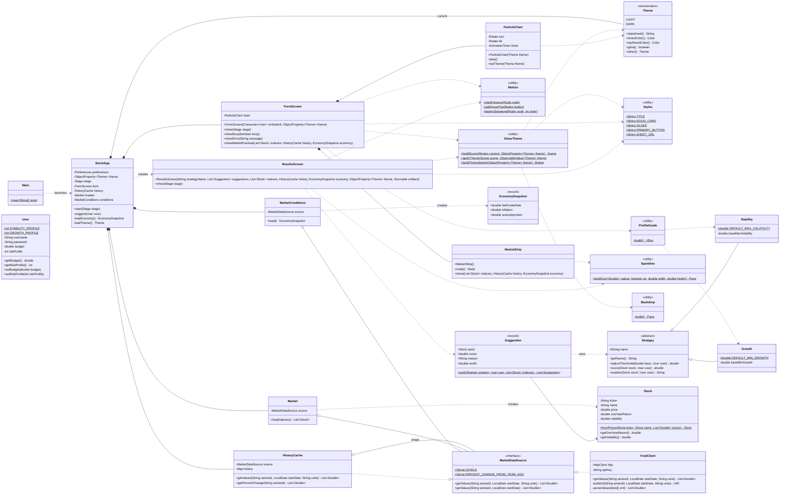
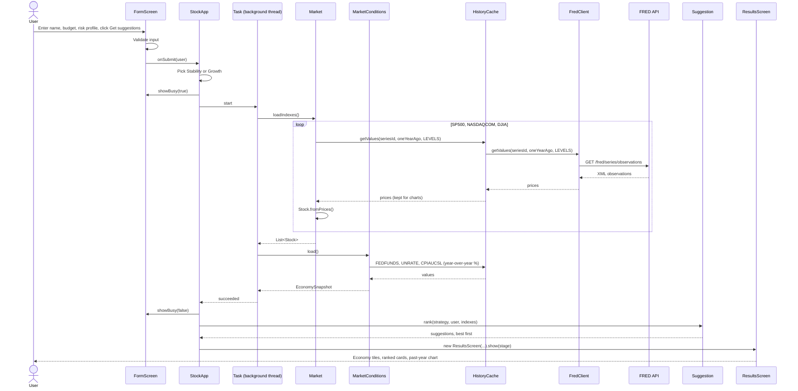
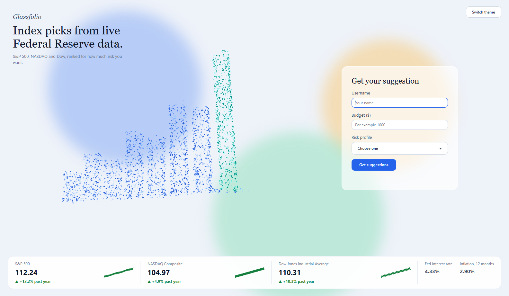
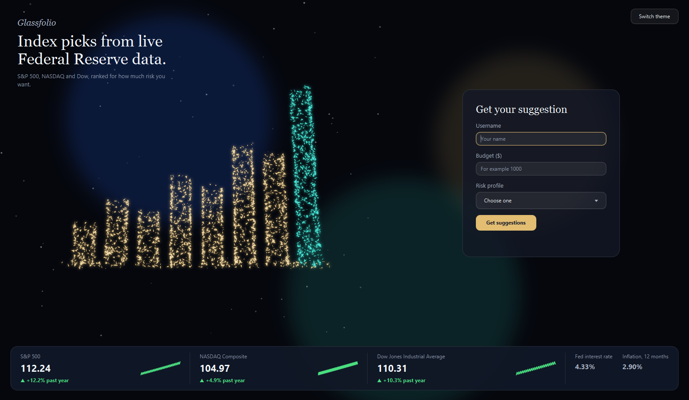
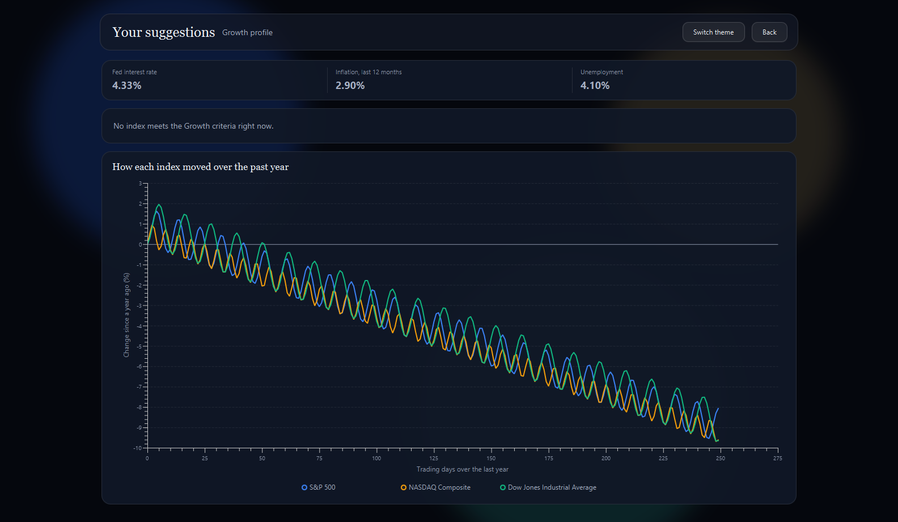

# Glassfolio design

## Class diagram

`+` public, `-` private, `#` protected. Hollow triangle = inheritance, dashed = implements an interface, diamond = has-a (composition).

### Design patterns used

| Pattern | Where | Why |
|---|---|---|
| Strategy | `Stratgey`, `Stability`, `Growth` | Each risk profile scores indexes its own way; callers only use `score()` and `explain()`. |
| Decorator | `HistoryCache` | Same `MarketDataSource` interface as `FredClient`, adds remembering each series for the charts. |
| Builder | `FredClient.buildUrl` (`StringBuilder`) | Builds the request URL step by step. |
| Factory method | `Stock.fromPrices` | Builds a `Stock` from raw prices so callers don't do the math. |
| MVC | Model: logic classes. View: `FormScreen`, `ResultsScreen`. Controller: `StockApp` | Screens only display; rules live in the model. |
| Observer | Button and `Task` event listeners; screens listen to the shared `theme` property | Event-driven GUI; switching the theme restyles every open screen at once. |
| Dependency injection | `StockApp` builds everything and passes it down | `Market` and `MarketConditions` work with any data source, including test fakes. |

## Sequence diagram: getting suggestions

If loading fails (bad key, no internet), the task's `onFailed` shows the error on the form instead.

## Window sizes

Both screens stretch to fill the window, from the 860×640 minimum up to full screen (F11). The 3D chart scales with its area's height, the background blobs and stars keep their places relative to the window, and the results page caps its width at 1280 px so lines stay easy to read, with the chart growing into any spare height.

Glassfolio is a desktop JavaFX app. It runs on Windows, macOS and Linux, not on phones.

## Themes

Every style refers to named colors (`-text`, `-accent`, `-surface` and so on). `Theme` defines them once for light and once for dark, so switching only swaps one small stylesheet. The 3D shards can't use CSS, so `Theme` also holds their colors and whether they glow. The choice is saved with Java's `Preferences`.

| Light | Dark |
|---|---|
|  |  |
|  |  |

## Storyboard

Screenshots use made-up sample data, not live FRED numbers, and the dark theme.

| Step | Screen |
|---|---|
| 1. Glowing shards assemble into a rising chart while the user fills in the form. A live market strip and a profile guide fill the rest of the screen. |  |
| 2. Glassfolio loads FRED data and ranks the indexes. The best pick is highlighted. |  |
| 3. If no index fits the profile, the app says so and still shows the chart. |  |
| 4. If the data can't load (for example a bad API key), the form shows why. |  |
