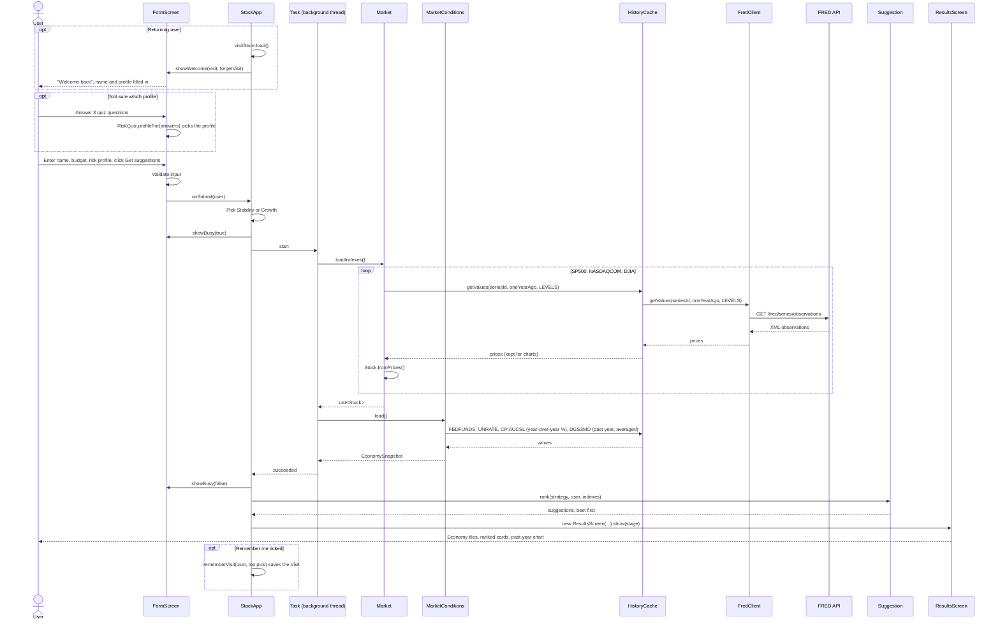
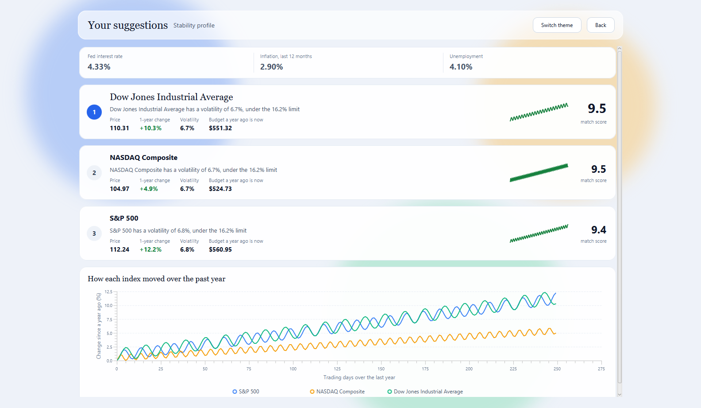
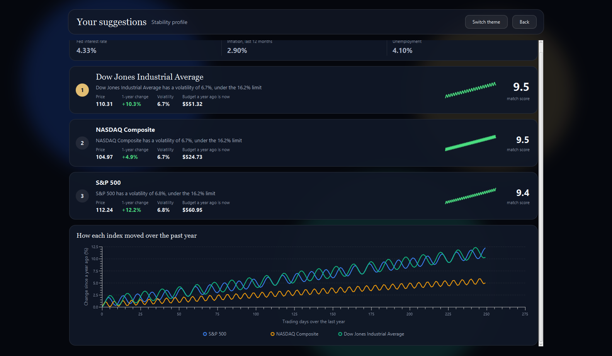
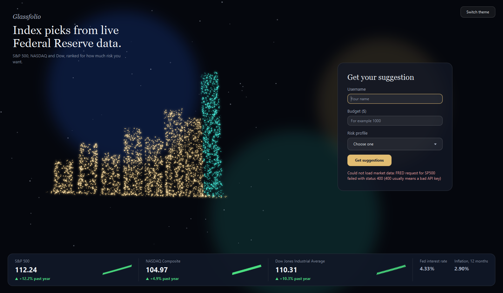

# Glassfolio design

## Class diagram

Classes live in four packages: `glassfolio` (`Main`), `glassfolio.gui`, `glassfolio.model` and `glassfolio.data`. The README lists which class is where.

`+` public, `-` private, `#` protected. Hollow triangle = inheritance, dashed = implements an interface, diamond = has-a (composition).

```mermaid
classDiagram
    direction LR

    class Main {
        +main(String[] args)$
    }
    class StockApp {
        -Preferences preferences
        -ObjectProperty~Theme~ theme
        -Stage stage
        -FormScreen form
        -KeyScreen keyScreen
        -ApiKeyStore keyStore
        -VisitStore visitStore
        -HistoryCache history
        -Market market
        -MarketConditions conditions
        +start(Stage stage)
        -connect(String key)
        -checkKey(String key, boolean remember)
        -suggest(User user)
        -showResults(User user, Loaded loaded, boolean fromForm)
        -loadPreview()
        -rememberVisit(User user, Stock top)
        -forgetVisit() boolean
        -loadEconomy() EconomySnapshot
    }
    class Theme {
        <<enumeration>>
        LIGHT
        DARK
        +stylesheet() String
        +shardColor() Color
        +topShardColor() Color
        +glow() boolean
        +other() Theme
    }
    class BootScreen {
        +BootScreen(Runnable onDone)
        +show(Stage stage)
    }
    class Chime {
        <<utility>>
        +play()$
    }
    class ResultsData {
        <<record>>
        +String strategyName
        +String rule
        +List~Suggestion~ picks
        +List~Suggestion~ missed
        +List~Stock~ indexes
        +HistoryCache history
        +EconomySnapshot economy
        +double budget
    }
    class FormScreen {
        -ParticleChart chart
        +FormScreen(Consumer~User~ onSubmit, ObjectProperty~Theme~ theme, Runnable onChangeKey)
        +show(Stage stage)
        +showBusy(boolean busy)
        +showError(String message)
        +showMarketPreview(List~Stock~ indexes, HistoryCache history, EconomySnapshot economy)
        +showWelcome(Visit visit, BooleanSupplier onForget)
        +remembersVisitor() boolean
        -showQuiz(boolean open)
        -pickProfile(int profile)
    }
    class KeyScreen {
        -PasswordField keyField
        -CheckBox rememberBox
        +KeyScreen(KeyListener onConnect, Consumer~String~ openLink, Runnable onBack)
        +show(Stage stage, boolean canGoBack)
        +showBusy(boolean busy)
        +showError(String message)
    }
    class ApiKeyStore {
        -Preferences preferences
        +isValidFormat(String key)$ boolean
        +clean(String typed)$ String
        +find(String environmentValue) String
        +save(String key)
        +forget()
    }
    class IndexChart {
        <<utility>>
        +build(List~Stock~ indexes, HistoryCache history, String topTicker)$ VBox
        -buildChart(List~Stock~ indexes, HistoryCache history, String topTicker, Period period)$ StackPane
        +dateOf(double day, int lastDay)$ LocalDate
    }
    class Period {
        <<enumeration>>
        WEEK
        MONTH
        THREE_MONTHS
        YEAR
        +label() String
        +window(List~Double~ changeSinceYearAgo) List~Double~
    }
    class ChartReadout {
        <<utility>>
        +attach(LineChart chart, NumberAxis days, NumberAxis change, List~String~ names, List~List~Double~~ values, IntFunction~String~ dateLabel)$ StackPane
    }
    class ParticleChart {
        -Rotate turn
        -Rotate tilt
        -AnimationTimer timer
        +ParticleChart(Theme theme)
        +play()
        +showData(double[] values)
        +setTheme(Theme theme)
        +monthlyValues(List~Double~ daily)$ double[]
    }
    class EconomyPanel {
        -GridPane grid
        +node() Node
        +show(EconomySnapshot economy)
    }
    class RiskQuiz {
        <<utility>>
        +List~Question~ QUESTIONS$
        +int GROWTH_THRESHOLD$
        +profileFor(int[] answers)$ int
    }
    class Visit {
        <<record>>
        +String name
        +int profile
        +String ticker
        +String pickName
        +double price
        +LocalDate date
    }
    class VisitStore {
        -Preferences preferences
        +save(Visit visit)
        +load() Visit
        +forget()
    }
    class RiskQuizPanel {
        -int[] chosen
        +RiskQuizPanel(IntConsumer onProfile, Runnable onCancel)
        +node() Node
        +start()
    }
    class AppIcon {
        <<utility>>
        +images()$ List~Image~
        +mark()$ HBox
    }
    class DotField {
        -double[] offsetX
        -double[] offsetY
        ~node() Canvas
    }
    class StarField {
        <<utility>>
        +build()$ Pane
    }
    class ResultsScreen {
        +ResultsScreen(ResultsData data, ObjectProperty~Theme~ theme, String switchLabel, Runnable onSwitch, Runnable onBack)
        +show(Stage stage)
    }
    class GlassTheme {
        <<utility>>
        +buildScene(ObjectProperty~Theme~ theme)$ Scene
        +buildRoot(Region content)$ Region
        +applyTheme(Scene scene, ObservableValue~Theme~ theme)$
        +buildThemeSwitch(ObjectProperty~Theme~ theme)$ Button
    }
    class Styles {
        <<utility>>
        +String HEADING$
        +String DISPLAY$
        +String TITLE$
        +String SOLID_CARD$
        +String PRIMARY_BUTTON$
        +String SECONDARY_BUTTON$
        +String WELL$
        +String SEGMENT$
        +String SHEET_URL$
        +double FRAME_RADIUS$
        +String FRAME$
        +String FRAME_SHADOW$
        +String HERO$
        +String NUMBER$
        +String SECTION$
        +String LABEL$
        +String BODY$
        +String META$
        +String PRIMARY_BUTTON_HOVER$
        +String SECONDARY_BUTTON_HOVER$
        +String LINK$
        +String TINT_BOX$
        +String GROUP_CARD$
        +String BOX_TITLE$
        +String CAPS$
        +String BRAND_PILL$
        +String BOX_TEXT$
        +String UP$
        +String DOWN$
        +String WELL_FOCUSED$
        +String BARE_FIELD$
        +String SEGMENT_SELECTED$
        +String ERROR$
        +String STATUS$
        +String BACKGROUND$
        +keepWholeText(Node node)$
        +clickable(Button button, String normal, String hover)$
        +shadowed(Region panel, double radius, String shadow)$ StackPane
        +wordmark()$ HBox
        +loadFonts()$
    }
    class Motion {
        <<utility>>
        +playEntrance(Node node)$
        +addHoverPop(Button button)$
        +fadeInStaggered(Node node, int order)$
        +addHoverLift(Node card)$
        +countUp(Label label, double value, DoubleFunction~String~ format, int order)$
    }
    class MarketStrip {
        +MarketStrip()
        +node() Node
        +show(List~Stock~ indexes, HistoryCache history)
    }
    class ProfileGuide {
        <<utility>>
        +String NOTE$
        +describe(boolean stability)$ String
    }
    class Sparkline {
        <<utility>>
        +build(List~Double~ values, boolean up, double width, double height)$ Pane
    }
    class Backdrop {
        <<utility>>
        +build()$ Pane
    }

    class User {
        +int STABILITY_PROFILE$
        +int GROWTH_PROFILE$
        -String username
        -String password
        -double budget
        -int riskProfile
        +getBudget() double
        +getRiskProfile() int
        +setBudget(double budget)
        +setRiskProfile(int riskProfile)
    }
    class Strategy {
        <<abstract>>
        -String name
        +Strategy(String name)
        +getName() String
        +adjustThreshold(double base, User user)* double
        +score(Stock stock, User user)* double
        +explain(Stock stock, User user)* String
        +explainMiss(Stock stock, User user)* String
        +rule(User user)* String
        +scoreMath(Stock stock, User user)* String
    }
    class Stability {
        +double DEFAULT_MAX_VOLATILITY$
        +double STABILITY_PROFILE_FACTOR$
        -double baseMaxVolatility
        +Stability(double baseMaxVolatility)
        +getBaseMaxVolatility() double
        +setBaseMaxVolatility(double baseMaxVolatility)
    }
    class Growth {
        +double DEFAULT_MIN_GROWTH$
        -double baseMinGrowth
        +Growth(double baseMinGrowth)
        +getBaseMinGrowth() double
        +setBaseMinGrowth(double baseMinGrowth)
    }
    class Stock {
        -String ticker
        -String name
        -double price
        -double oneYearReturn
        -double volatility
        -double yearHigh
        -double yearLow
        -double biggestDrop
        +fromPrices(String ticker, String name, List~Double~ prices)$ Stock
        +getOneYearReturn() double
        +getVolatility() double
        +worstCaseValue(double amount) double
    }
    class Suggestion {
        <<record>>
        +Stock stock
        +double score
        +String reason
        +String math
        +double worth
        +rank(Strategy strategy, User user, List~Stock~ indexes)$ List~Suggestion~
        +missed(Strategy strategy, User user, List~Stock~ indexes)$ List~Suggestion~
    }

    class MarketDataSource {
        <<interface>>
        +String LEVELS$
        +String PERCENT_CHANGE_FROM_YEAR_AGO$
        +getValues(String seriesId, LocalDate startDate, String units)* List~Double~
        +getValues(String seriesId, LocalDate startDate) List~Double~
    }
    class FredClient {
        -HttpClient http
        -String apiKey
        +getValues(String seriesId, LocalDate startDate, String units) List~Double~
        -buildUrl(String seriesId, LocalDate startDate, String units) URI
        -parseValues(byte[] xml) List~Double~
    }
    class HistoryCache {
        -MarketDataSource source
        -Map history
        +getValues(String seriesId, LocalDate startDate, String units) List~Double~
        +getPercentChange(String seriesId) List~Double~
    }
    class Market {
        -MarketDataSource source
        +loadIndexes() List~Stock~
    }
    class MarketConditions {
        -MarketDataSource source
        +load() EconomySnapshot
    }
    class EconomySnapshot {
        <<record>>
        +double fedFundsRate
        +double inflation
        +double unemployment
        +double savingsRate
        +savingsWorth(double budget) double
        +realReturn(double nominalPercent) double
    }

    Main ..> StockApp : launches
    StockApp *-- FormScreen
    StockApp *-- KeyScreen
    ResultsScreen ..> IndexChart
    IndexChart ..> ChartReadout
    IndexChart ..> Period
    StockApp *-- ApiKeyStore
    KeyScreen ..> ApiKeyStore : checks format
    FredClient ..> ApiKeyStore : checks format
    StockApp ..> ResultsScreen : creates
    StockApp ..> BootScreen : shows first
    BootScreen ..> Chime
    ResultsScreen ..> ResultsData
    StockApp *-- HistoryCache
    StockApp *-- Market
    StockApp *-- MarketConditions
    StockApp *-- Theme : current
    GlassTheme ..> Theme
    ParticleChart ..> Theme
    FormScreen *-- ParticleChart
    FormScreen *-- MarketStrip
    FormScreen *-- EconomyPanel
    FormScreen *-- RiskQuizPanel
    RiskQuizPanel ..> RiskQuiz
    StockApp *-- VisitStore
    StockApp ..> AppIcon : window icon
    Backdrop *-- DotField
    Styles ..> AppIcon : wordmark
    VisitStore ..> Visit : saves and loads
    FormScreen ..> StarField
    FormScreen ..> ProfileGuide
    MarketStrip ..> Sparkline
    ResultsScreen ..> Sparkline
    ProfileGuide ..> Stability
    ProfileGuide ..> Growth
    FormScreen ..> GlassTheme
    ResultsScreen ..> GlassTheme
    GlassTheme ..> Backdrop
    GlassTheme ..> Styles
    FormScreen ..> Styles
    ResultsScreen ..> Styles
    FormScreen ..> Motion
    Styles ..> Motion : clickable() adds the hover pop
    ResultsScreen ..> Motion
    ResultsScreen ..> Suggestion
    Strategy <|-- Stability
    Strategy <|-- Growth
    MarketDataSource <|.. FredClient
    MarketDataSource <|.. HistoryCache
    HistoryCache o-- MarketDataSource : wraps
    Market o-- MarketDataSource
    MarketConditions o-- MarketDataSource
    Market ..> Stock : creates
    MarketConditions ..> EconomySnapshot : creates
    Suggestion --> Stock
    Suggestion ..> Strategy : uses
```

### Design patterns used

| Pattern | Where | Why |
|---|---|---|
| Strategy | `Strategy`, `Stability`, `Growth` | Each risk profile scores indexes its own way; callers only use `score()` and `explain()`. |
| Decorator | `HistoryCache` | Same `MarketDataSource` interface as `FredClient`, adds remembering each series for the charts. |
| Builder | `FredClient.buildUrl` (`StringBuilder`) | Builds the request URL step by step. |
| Factory method | `Stock.fromPrices` | Builds a `Stock` from raw prices so callers don't do the math. |
| Parameter object | `ResultsData` | Groups what the results screen shows, so its constructor stays short. |
| One Scene, swapped roots (deliberate exception to "each screen is its own scene") | `StockApp`, `GlassTheme.buildScene` | Each screen still builds its own root, but they share one Scene so full screen and the theme stay on when switching. |
| Template method / polymorphism | `Strategy.explain` and `explainMiss` | Each strategy explains its own picks and misses; the screen just calls the method. |
| MVC | Model: logic classes. View: `FormScreen`, `ResultsScreen`. Controller: `StockApp` | Screens only display; rules live in the model. |
| Observer | Button and `Task` event listeners; screens listen to the shared `theme` property | Event-driven GUI; switching the theme restyles every open screen at once. |
| Dependency injection | `StockApp` builds everything and passes it down | `Market` and `MarketConditions` work with any data source, including test fakes. |

## Sequence diagram: getting suggestions

If loading fails (bad key, no internet), the task's `onFailed` shows the error on the form instead.

## Security and QA

| Concern | What Glassfolio does | Where |
|---|---|---|
| Secrets | The FRED API key is never written in the code or repo. Users paste it into a masked field on the key screen; the app tests it with one FRED request before saving it. The Remember box starts unticked; with it ticked, it is saved in the current user's Java preferences (on Windows the registry under that user, which other accounts can't read, like an environment variable; on macOS and Linux a plain-text file in the user's home folder). Unticked, the saved key is deleted and the key lives only in memory. The `FRED_API_KEY` environment variable still works for developers. The key is never logged or shown, and the field is cleared each time the screen opens. | `KeyScreen`, `ApiKeyStore`, `StockApp.checkKey`, `FredClient` constructor |
| Network | Only HTTPS to `api.stlouisfed.org`. Connect (10 s) and request (30 s) timeouts, so a slow server can't freeze the app. Any status other than 200 becomes an error. | `FredClient` |
| Sanitization | Every URL value is encoded with `URLEncoder` before it goes into the request. The API key must also be exactly 32 lowercase letters and digits (FRED's format), so nothing else can reach the URL. | `FredClient.buildUrl`, `ApiKeyStore.isValidFormat` |
| Untrusted data | The XML parser refuses DOCTYPEs, which blocks XXE attacks (a response trying to read local files). A value that isn't a number stops the load instead of being guessed. | `FredClient.parseValues` |
| Input validation | The budget field only lets digits and one decimal point be typed (up to 2 decimals). The form also rejects empty, `NaN` and `Infinity` values, and every constructor rejects out-of-range values with `IllegalArgumentException`. | `FormScreen`, `User`, `Stock`, `FredClient` |
| Exception handling | Only specific exceptions are caught, and each one is either shown to the user in plain words or rethrown with its cause. Nothing is silently swallowed. | `FredClient`, `FormScreen`, `StockApp`, `Chime` |
| Stored data | Only the API key (if the user asks) and the last visit are saved on the computer: the name, profile and top pick with its price, so the start screen can say "Welcome back", and only while "Remember me on this computer" is ticked (it starts unticked) (unticking it deletes the visit). "Not you?" deletes the visit but not the API key; if deleting fails, the form says so. Loaded values are checked (series id format, name lengths, no future dates). Only error types are logged, never the name. Both live in the current user's Java preferences and never leave the computer. A tampered key or visit is ignored, so the key screen opens again. No budget or name is stored or sent anywhere except the FRED request, which contains only series ids and dates. | `StockApp` |
| No back doors | No hidden accounts, debug switches, shell commands or extra endpoints. The `password` field in `User` is a placeholder for a future sign-in; the form passes an empty one and it is never stored or sent. | `User` |
| Threading | FRED data loads on a background `Task`; the screens only update on the JavaFX thread. The cache shared between the two uses a `ConcurrentHashMap`. | `StockApp`, `HistoryCache` |
| Memory vs. speed | `HistoryCache` keeps each series after the first load, so charts never call FRED twice. The 3D chart's timer stops when nothing moves or the chart is off-screen. | `HistoryCache`, `ParticleChart` |

**QA:** `test/ModelTest.java` runs 89 checks with a fake data source (no internet): the math, both strategies, ranking, left-out reasons, the "Why this pick?" rule and score math, the savings comparison, chart periods, the risk quiz, the saved visit, worst case and inflation math, the API key store, the chime's audio and input rejection (including NaN and infinite values). Each change is compiled with `-Xlint:all` (no warnings) and the tests are run before committing.

## Window sizes

Both screens stretch to fill the window, from the 860×640 minimum up to full screen (F11). The 3D chart scales with its area's height, the background blobs and stars keep their places relative to the window, and the results page caps its width at 1280 px so lines stay easy to read, with the chart growing into any spare height.

Glassfolio is a desktop JavaFX app. It runs on Windows, macOS and Linux, not on phones.

## Themes

The light theme is pink-violet glass with a violet accent; the dark theme is deep teal and navy with a lime accent. Type is Poppins throughout: Regular for body text, Medium for big numbers, SemiBold for headings, labels and buttons. The tinted boxes use four theme colors, `-tint-1`, `-tint-2`, `-glow` and `-edge`, so each theme has its own tint.

Every style refers to named colors (`-text`, `-accent`, `-surface` and so on). `Theme` defines them once for light and once for dark, so switching only swaps one small stylesheet. The 3D shards can't use CSS, so `Theme` also holds their colors and whether they glow. The app always starts in the light theme, the glass look; the switch changes it for that session.

| Light | Dark |
|---|---|
|  |  |
|  |  |

## Storyboard

Screenshots use made-up sample data, not live FRED numbers, and the dark theme.

| Step | Screen |
|---|---|
| 0. A short startup animation and chime; a click or key skips it. | (animation, no screenshot) |
| 1. Glowing shards assemble into a rising chart while the user fills in the form. Once data loads, the shards reshape into the S&P 500's last 12 months. A market strip with the latest FRED values and a profile guide fill the rest of the screen. |  |
| 2. Glassfolio loads FRED data and ranks the indexes. The best pick is highlighted, left-out indexes say why, and one click shows the other profile. |  |
| 3. If no index fits the profile, the app says so and still shows the chart. |  |
| 4. If the data can't load (for example a bad API key), the form shows why. |  |
